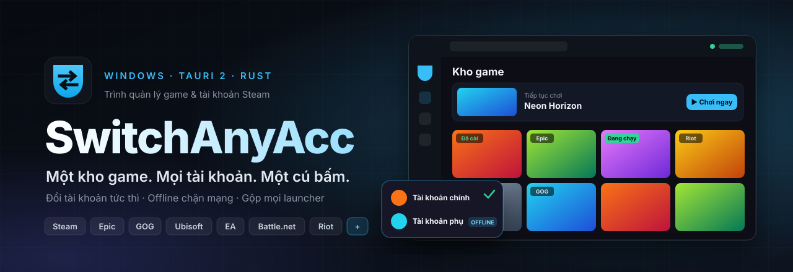

<!-- Trang này do scripts/release.mjs (repo mã nguồn) sinh tự động mỗi lần phát hành — đừng sửa tay. -->

  

  
  
  
  

<h3 align="center">
  <a href="https://github.com/diegonguyen86/SwitchAnyApp-Release/releases/download/v1.2.0/SwitchAnyAcc_1.2.0_x64-setup.exe">⬇️&nbsp;&nbsp;Tải SwitchAnyAcc 1.2.0</a>
</h3>

SwitchAnyAcc_1.2.0_x64-setup.exe · 24.7 MB · phát hành 18/11/2026 · bộ cài đã ký, tự cập nhật · <a href="https://github.com/diegonguyen86/SwitchAnyApp-Release/releases">tất cả phiên bản</a>

---

## ✨ Vì sao là SwitchAnyAcc?

<table>
  <tr>
    <td width="50%" valign="top">
      <h3>⚡ Đổi tài khoản 1 chạm</h3>
      Chọn game → chọn tài khoản → bấm <b>Chơi</b>. App tự đóng Steam an toàn, đổi tài khoản, mở lại Steam và vào thẳng game. Không gõ lại mật khẩu, không mò menu.
    </td>
    <td width="50%" valign="top">
      <h3>🛡️ Offline chặn mạng thật sự</h3>
      Chế độ <b>Offline</b> dùng Windows Firewall chặn riêng Steam — kể cả khi bạn đang tắt Firewall. Game và app khác vẫn có mạng. Tắt chế độ là khôi phục đúng như cũ.
    </td>
  </tr>
  <tr>
    <td width="50%" valign="top">
      <h3>🎮 Một kho cho mọi launcher</h3>
      Tự nhận game đã cài của <b>Steam, Epic, GOG, Ubisoft Connect, EA app, Battle.net, Riot</b>. Thêm game ngoài bằng file .exe hoặc quét cả thư mục <code>D:\Games</code> trong vài giây.
    </td>
    <td width="50%" valign="top">
      <h3>🖼️ Đẹp, gọn, tự lo phần khó</h3>
      Ảnh bìa tự tìm, đo giờ chơi, "Tiếp tục chơi", ghim / ẩn game, lọc theo nguồn, giao diện Tối / Sáng. Chạy ngầm dưới khay, khởi động cùng Windows.
    </td>
  </tr>
  <tr>
    <td width="50%" valign="top">
      <h3>☁️ Steam Cloud trong tầm tay</h3>
      Bật / tắt Cloud theo từng game và từng tài khoản. Chơi Offline thì Cloud tự tắt để save trên máy không bị ghi đè.
    </td>
    <td width="50%" valign="top">
      <h3>🚀 Nhẹ và tự cập nhật</h3>
      Bộ cài chỉ ~24.7 MB (vỏ Rust + Tauri 2). Có bản mới là app tự tải ngầm, bạn chỉ bấm <b>Khởi động lại để cập nhật</b> — dữ liệu giữ nguyên.
    </td>
  </tr>
</table>

## 🧩 Launcher được hỗ trợ

| Launcher | Nhận game đã cài | Mở game | Đo giờ chơi |
|:--|:--:|:--:|:--:|
| **Steam** (nhiều tài khoản) | ✅ cả game chưa cài | ✅ đổi tài khoản + Online / Offline | ✅ |
| **Epic Games** | ✅ | ✅ qua Epic Launcher | ✅ |
| **GOG** | ✅ | ✅ chạy thẳng, không cần Galaxy | ✅ |
| **Ubisoft Connect** | ✅ | ✅ | ✅ |
| **EA app** | ✅ | ✅ (thử nghiệm) | ✅ |
| **Battle.net** | ✅ | ✅ | ✅ |
| **Riot Games** | ✅ | ✅ qua Riot Client | ✅ |
| **Game tự thêm** | chọn .exe / quét thư mục | ✅ | ✅ |

## 📥 Cài đặt

1. Tải **[SwitchAnyAcc_1.2.0_x64-setup.exe](https://github.com/diegonguyen86/SwitchAnyApp-Release/releases/download/v1.2.0/SwitchAnyAcc_1.2.0_x64-setup.exe)** rồi chạy.
2. Windows SmartScreen có thể báo *"Windows protected your PC"* vì bộ cài chưa mua chứng chỉ ký mã → bấm **More info** → **Run anyway**.
3. Lần đầu muốn dùng chế độ **Offline**, vào **Cài đặt → Tường lửa** và bấm cài (cần quyền Admin đúng 1 lần).

> Đã có bản cũ? Cứ chạy bộ cài mới; nếu được hỏi *"Already Installed"* thì chọn **Do not uninstall**. Từ bản 1.1.1 trở đi app tự cập nhật, không cần tải tay.

## 🆕 Có gì mới trong 1.2.0

- Giao diện mới: thanh bên có đủ các launcher với màu riêng, số game và trạng thái đang mở
- Trang Launcher mới: xem Steam, Epic, GOG, Ubisoft, EA, Battle.net, Riot trên máy, mở nhanh từng launcher
- Kho game đẹp hơn: banner Tiếp tục chơi, lọc nhanh theo launcher, nhãn Đang chơi, thanh tiến độ khi Steam đang tải game
- Cài / gỡ game hiện ngay trên app (Steam, Epic, Riot tức thì
- launcher khác trong 15 giây)
- Ngăn chi tiết game theo từng bước dễ hiểu

Xem toàn bộ lịch sử ở **[CHANGELOG.md](CHANGELOG.md)**.

## ❓ Câu hỏi thường gặp

<b>Dữ liệu của tôi lưu ở đâu? Gỡ app có mất không?</b>

 
Mọi thứ nằm ở <code>%LOCALAPPDATA%\SwitchAnyAcc</code>. Gỡ cài đặt hoặc cập nhật chỉ thay file chương trình — danh sách game, lựa chọn tài khoản, giờ chơi, ảnh bìa tự chọn đều giữ nguyên.

<b>App có lưu mật khẩu Steam không?</b>

 
Không. App đổi tài khoản bằng phiên đăng nhập Steam đã lưu sẵn trên máy. Nếu bạn dùng tính năng đăng nhập trong app, phiên được mã hoá bằng Windows DPAPI (chỉ tài khoản Windows của bạn giải được) và không bao giờ ghi ra nhật ký.

<b>Có gửi dữ liệu của tôi đi đâu không?</b>

 
Không có tài khoản riêng của app, không theo dõi, không quảng cáo. App chỉ gọi Steam (tra tên / ảnh bìa game, và đăng nhập nếu bạn dùng tính năng đó) và đọc file <code>latest.json</code> trong repo này để kiểm tra bản mới.

<b>Bản cập nhật có an toàn không?</b>

 
Mỗi bộ cài được ký bằng khoá riêng của tác giả; app kiểm chữ ký (và đúng số phiên bản) trước khi cài. File bị sửa hoặc giả mạo sẽ bị từ chối.

<b>Vì sao cần quyền Admin cho Tường lửa?</b>

 
Để tạo luật chặn mạng cho Steam và 2 tác vụ hệ thống bật / tắt luật đó. Cài một lần; sau đó app bật / tắt chặn mạng mà không hỏi UAC nữa.

---

  ⚠️ Điều khoản của Steam không cho phép chia sẻ / cho thuê tài khoản — bạn tự chịu trách nhiệm với cách mình sử dụng. 
  Repo này chỉ chứa bộ cài, không có mã nguồn. © diegonguyen86 — mọi quyền được bảo lưu.

